# Inhibitor Command Center

An animated, multi-monitor sci-fi lab terminal for Windows, built with Electron and three.js.
It runs as a full-screen app or as a Windows screensaver: the main display shows the
command center (hormone levels, firmware compiler, inhibitor prototype inspector,
fabrication progress), and every extra monitor shows the analysis terminal with a voxel DNA helix.

Unofficial fan project, inspired by the Spider-Man films. Not affiliated with or endorsed
by Marvel, Disney or Sony. See [Trademarks](THIRD_PARTY_NOTICES.md#trademarks).

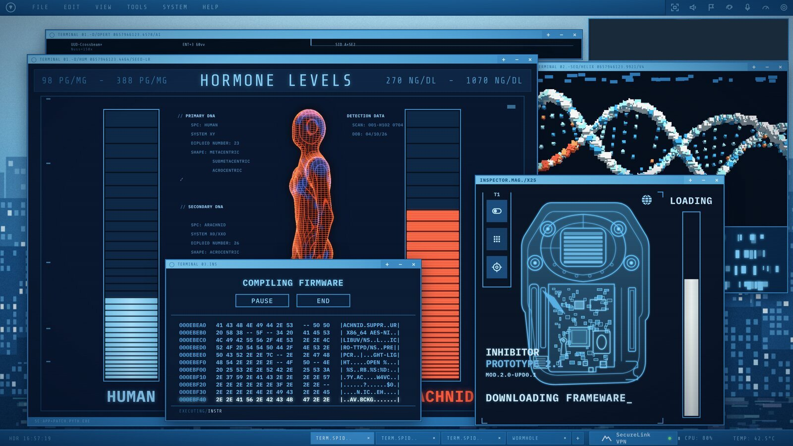

## Demo video

Watch the demo: **[InhibitorCommandCenter-demo.mp4](https://github.com/itbelikethatbruh/Inhibitor-Command-Center-Spiderman-/releases/latest/download/InhibitorCommandCenter-demo.mp4)** (attached to the latest release).

## Download (Windows x64)

1. Go to [Releases](https://github.com/itbelikethatbruh/Inhibitor-Command-Center-Spiderman-/releases/latest) and download `InhibitorCommandCenter-win.zip`.
2. Optional: verify it. In PowerShell run
   `Get-FileHash .\InhibitorCommandCenter-win.zip -Algorithm SHA256`
   and compare the hash with `InhibitorCommandCenter-win.zip.sha256` from the same release.
3. Unzip anywhere and run `Inhibitor Command Center.exe`.

> **The exe is not code-signed, so Windows SmartScreen will warn you** ("Windows protected your PC").
> Click **More info**, then **Run anyway**. Check the SHA-256 first if you want to be sure the file
> is the one published here.

### Controls

- **F11** toggles full screen (app mode).
- `--single` limits it to the primary monitor.
- Screensaver flags follow Windows convention: `/s` run, `/c` settings, `/p` preview.

### Use it as a screensaver

Copy `Inhibitor Command Center.exe` (with the rest of the unzipped folder) and rename the exe to
`Inhibitor Command Center.scr`, then right-click it and choose **Install**. Moving the mouse or
pressing a key exits it.

## Screenshots

| | |
|---|---|
| 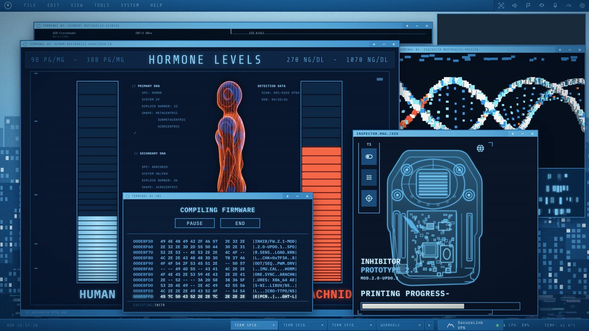 | 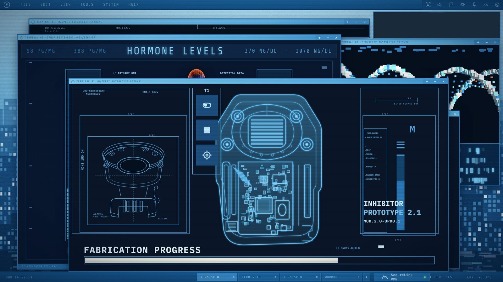 |
| Printing progress | Fabrication screen |
| 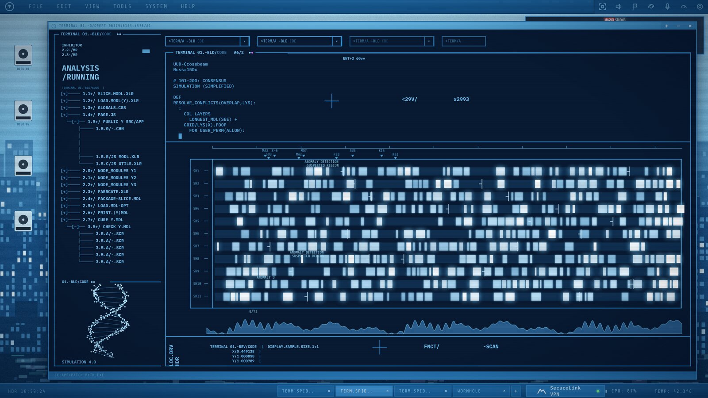 | 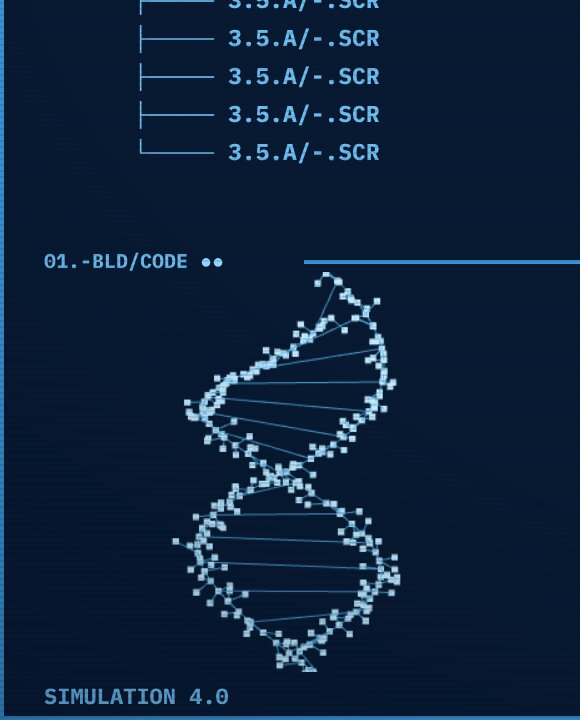 |
| Analysis terminal | Simulation wireframe DNA |
| 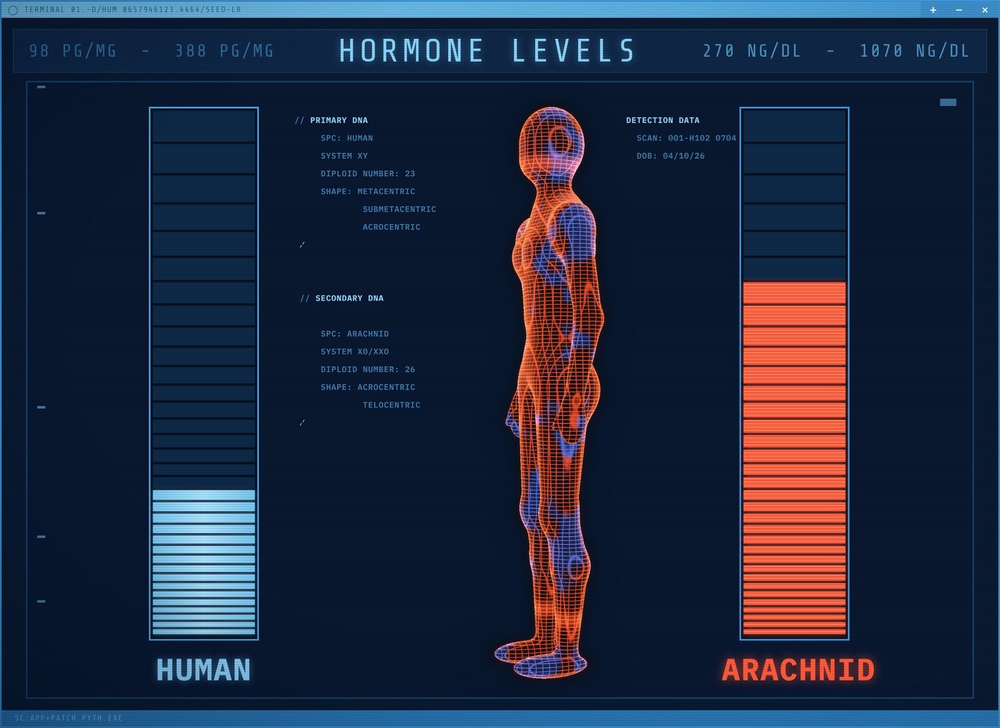 | 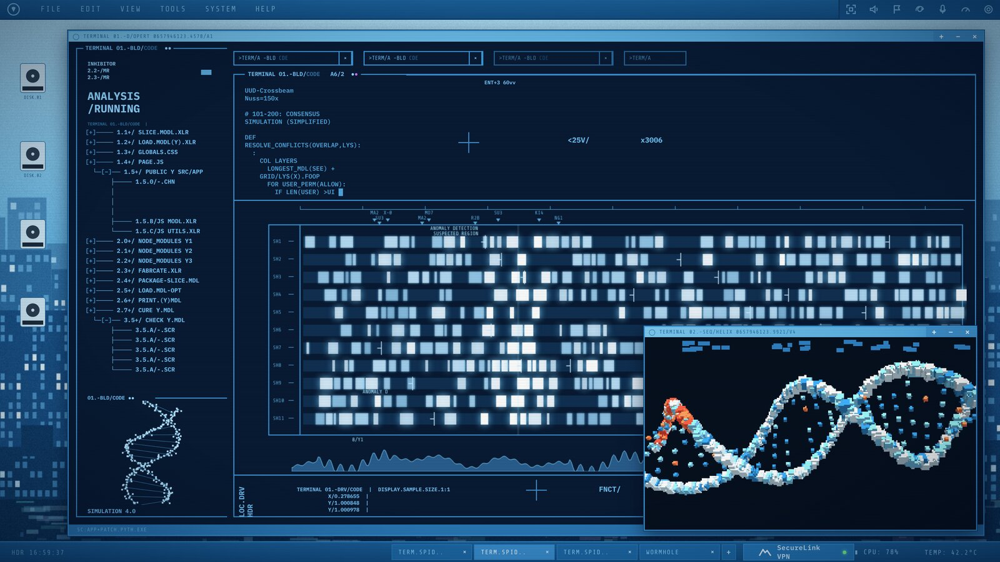 |
| Hormone levels | Second-monitor layout |
| 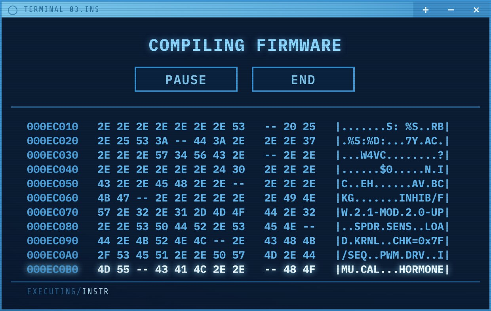 | 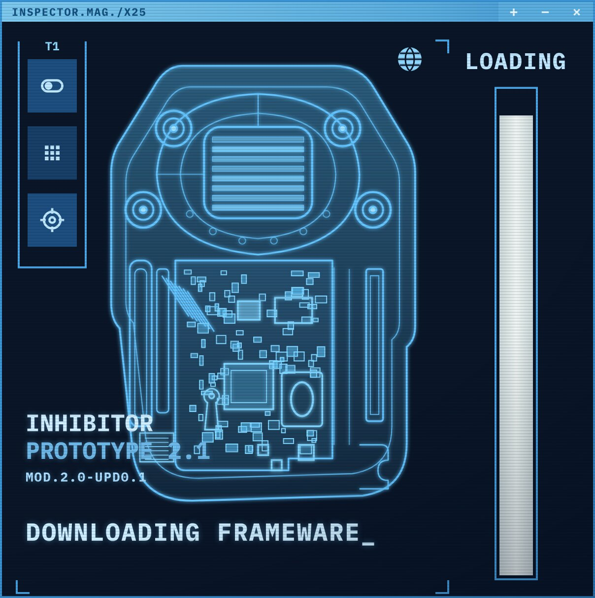 |
| Firmware compiler | Inhibitor prototype inspector |
| 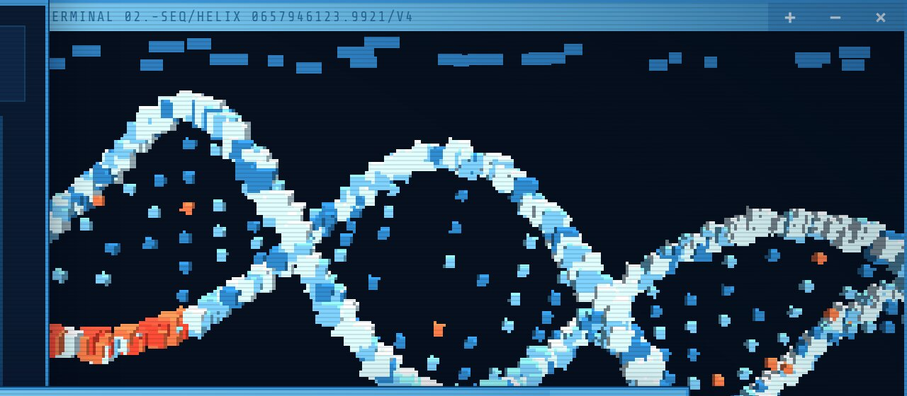 | 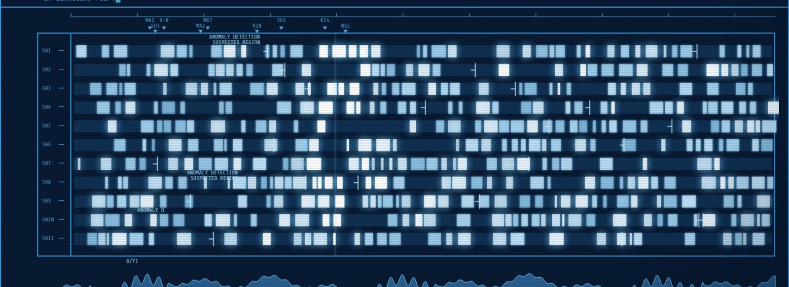 |
| Voxel DNA helix | Chromosome band grid |

<p>
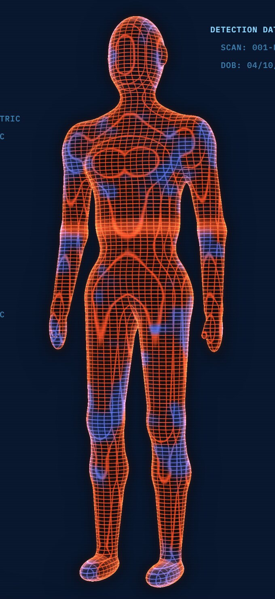
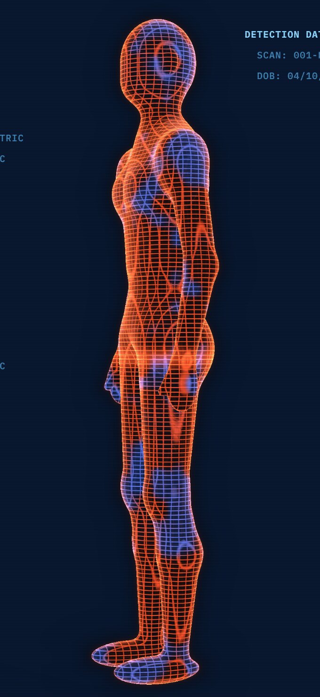
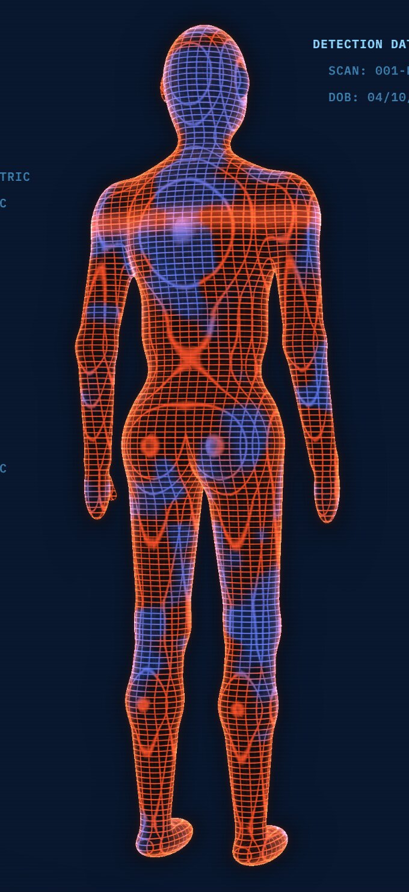
</p>

## Build from source

Requires Node.js 18+.

```bash
cd app && npm install && cd ..        # app deps (none at runtime besides Electron)
npm install                           # electron-builder
npx electron-builder --win            # outputs dist/InhibitorCommandCenter.exe (portable) and a zip
```

To just run it: `npx electron@33.2.1 app`. You can also open `app/index.html` in a browser
(`?screen=2` shows the second-monitor layout).

### Title logo

The top-right title panel loads `app/logo.png` if it exists and hides itself otherwise.
No logo ships with this repo, because film logos are not ours to license. Drop your own PNG
(about 900 x 280) there for a personal build. It is git-ignored.

## License

Copyright (C) 2026 Drake ([@itbelikethatbruh](https://github.com/itbelikethatbruh)).

Licensed under the **GNU Affero General Public License v3.0 only** (AGPL-3.0-only). See [LICENSE](LICENSE).
Bundled third-party components (three.js, Share Tech Mono, IBM Plex Mono) keep their own
licenses, listed in [THIRD_PARTY_NOTICES.md](THIRD_PARTY_NOTICES.md).
